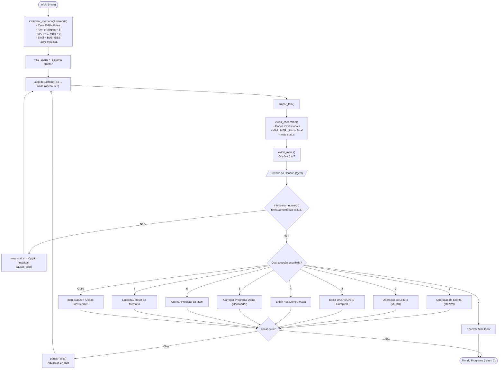
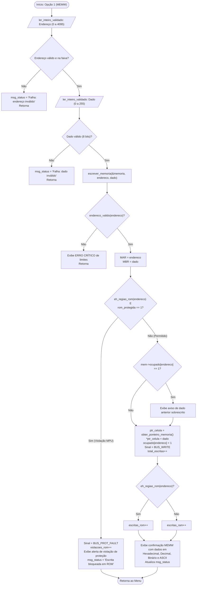
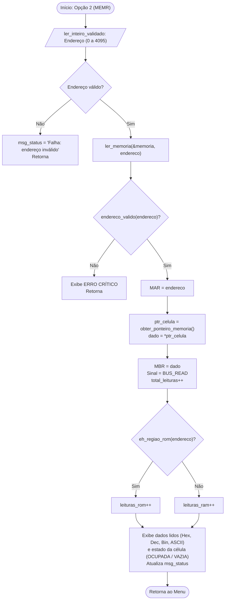
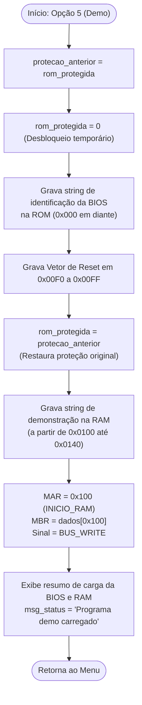
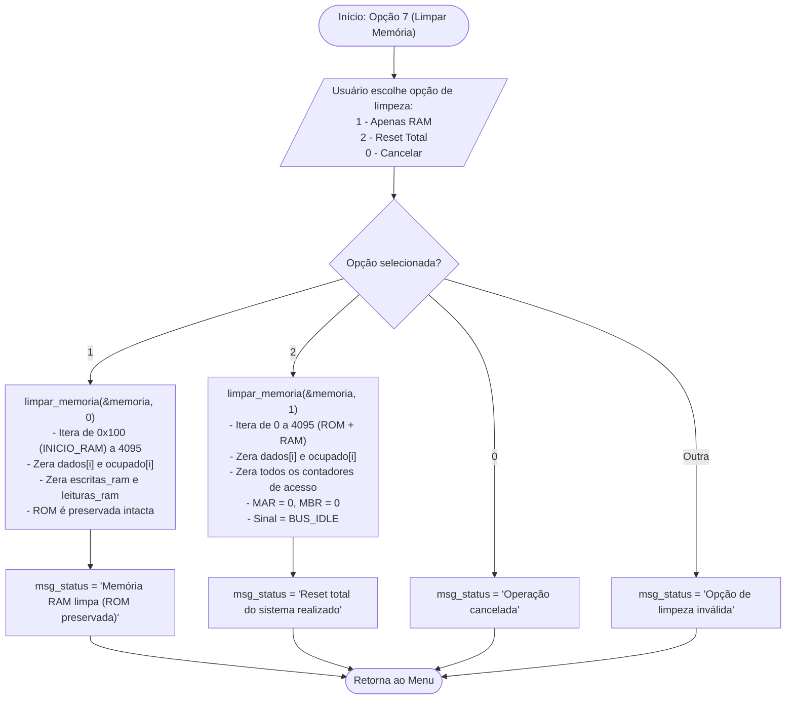
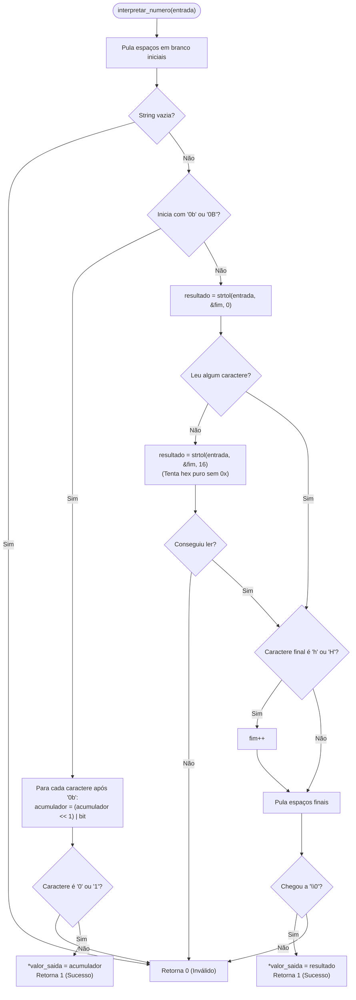

# Especificação e Fluxogramas do Sistema: Simulador de Memória (ROM + RAM)

**Universidade Federal do Maranhão (UFMA)**  
**Centro de Ciências Exatas e Tecnologia (CCET) — Departamento de Informática**  
**Disciplina:** Arquitetura de Computadores  
**Autores:** Caio Ferreira Sousa, Danilo Nava Soares Lima, Raynara Ribeiro Alves, Rhuã Yuri Nascimento Sardinha, Yuri Aguiar Gonçalves  
**Código-fonte de referência:** [simulador_ram.c](file:///home/yuri/Documentos/UFMA/Computacao/Arquitetura%20de%20Computadores/projeto/documentos/simulador_ram.c)

---

## 1. Visão Geral da Arquitetura Simulada

O sistema implementa uma simulação da arquitetura de barramentos e subsistema de memória (modelo Von Neumann) com as seguintes características:
- **Espaço Total:** 4096 bytes (4 KB, endereçamento de 12 bits: `0x000` a `0xFFF`).
- **Segmento ROM (BIOS/Bootloader):** Endereços `0x000` a `0x0FF` (0 a 255 — 256 bytes) com proteção configurável contra escrita (MPU).
- **Segmento RAM:** Endereços `0x100` a `0xFFF` (256 a 4095 — 3840 bytes) para leitura e escrita irrestritas.
- **Barramentos e Registradores:**
  - **MAR (*Memory Address Register*):** Armazena o endereço ativo selecionado para a operação.
  - **MBR/MDR (*Memory Buffer Register*):** Armazena o dado trafegado no barramento de dados (8 bits).
  - **Linhas de Controle:** Sinais `BUS_IDLE`, `BUS_READ` (MEMR), `BUS_WRITE` (MEMW) e `BUS_PROT_FAULT`.

---

## 2. Fluxograma Geral do Sistema (`main`)

O loop principal gerencia a inicialização, a exibição do cabeçalho e menu com atualização em tempo real, o roteamento da opção selecionada pelo usuário e a persistência do estado até o encerramento.

---

## 3. Fluxograma da Operação de Escrita (`MEMW` - Opção 1)

Ilustra a lógica de validação de formato numérico, envio de endereço ao MAR, barramento de dados ao MBR, verificação de violação da ROM (MPU) e armazenamento físico em célula de memória.

---

## 4. Fluxograma da Operação de Leitura (`MEMR` - Opção 2)

Ilustra o ciclo de busca de dados no subsistema de memória através do MAR e MBR.

---

## 5. Fluxograma de Carga do Bootloader / Programa Demo (Opção 5)

Processo de gravação de fábrica simulando a gravação física de firmware na ROM e inicialização do espaço de dados na RAM.

---

## 6. Fluxograma de Limpeza e Reset do Sistema (Opção 7)

Apresenta as opções de reset parcial (apenas variáveis em RAM) versus reset a frio completo (ROM, RAM, métricas e registradores).

---

## 7. Fluxograma do Analisador Léxico Flexível (`interpretar_numero`)

Rotina fundamental que permite a entrada unificada em múltiplas bases numéricas (Decimal, Hexadecimal com prefixo `0x` ou sufixo `h`, e Binário com `0b`).

---

## 8. Resumo das Estruturas e Papéis na Arquitetura

| Componente | Tipo / Representação | Papel Arquitetural |
| :--- | :--- | :--- |
| `dados[4096]` | `uint8_t[]` | Matriz física de células de armazenamento de 8 bits. |
| `ocupado[4096]` | `uint8_t[]` | Tabela de validade/presença (*valid bit*) de dados gravados. |
| `mar` | `int` (12 bits úteis) | *Memory Address Register* — Ponteiro de barramento de endereços. |
| `mbr` | `uint8_t` (8 bits) | *Memory Buffer Register* — Registrador de transferência de dados. |
| `rom_protegida` | `int` (0 ou 1) | Mecanismo de hardware simulado de MPU (*Memory Protection Unit*). |
| `ultimo_sinal` | `SinalBarramento` | Linhas de controle do barramento de sistema (`MEMR`, `MEMW`, `PROT_FAULT`, `IDLE`). |
